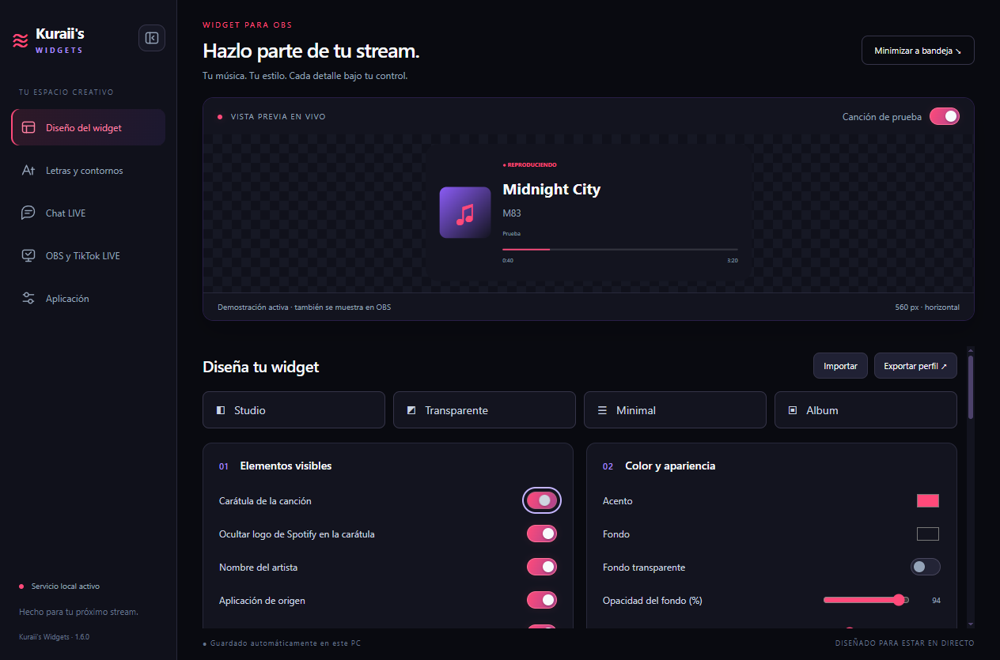
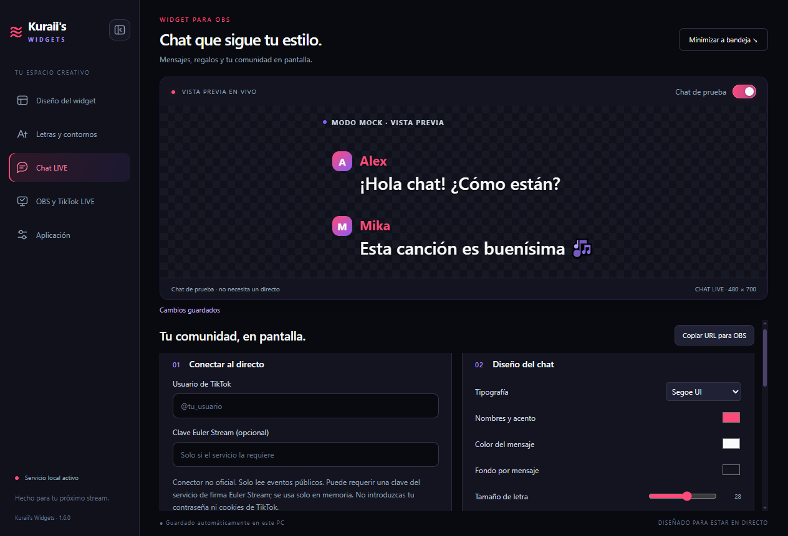

# Kuraii's Widgets

[](https://github.com/FrancoEvil/Kuraiis-Widgets/actions/workflows/windows.yml)
[](https://github.com/FrancoEvil/Kuraiis-Widgets/releases/latest)

**Música y comunidad con tu estilo.** Una aplicación de escritorio para Windows con widgets personalizables de NowPlaying y chat de TikTok LIVE para OBS y TikTok LIVE Studio.

[Descargar para Windows](https://github.com/FrancoEvil/Kuraiis-Widgets/releases/latest) · [Reportar un problema](https://github.com/FrancoEvil/Kuraiis-Widgets/issues)



## Chat de TikTok LIVE



1. Abre **Chat LIVE** e introduce el @usuario del creador que está en directo.
2. Si el servicio de firma requiere una clave de Euler Stream, introdúcela en el campo opcional. No se guarda en el perfil ni se incluye en el overlay. No introduzcas cookies ni tu contraseña de TikTok.
3. Pulsa **Conectar**. Verás el estado, los mensajes aceptados y los filtrados.
4. Copia la URL del chat a una fuente Navegador de OBS de **480 × 700**:

   ```text
   http://127.0.0.1:17834/chat
   ```

Para probarlo sin estar en vivo, activa **Chat de prueba** en la vista previa o usa:

```text
http://127.0.0.1:17834/chat?mock=true
```

El modo mock genera ejemplos en el navegador y no conecta a un directo. Puedes diseñar nombres, mensajes, fuente, tamaño y fondos por mensaje. El documento del overlay es completamente transparente.

- Anti-spam con deduplicación por usuario durante 30 segundos, límite de emojis y separación mínima entre mensajes.
- Regalos: las rachas se muestran una sola vez con su cantidad final.
- Máximo de mensajes visibles entre 1 y 80; tiempo de desvanecimiento entre 0 y 300 segundos. Tiempo 0 desactiva el fade-out, no el límite del DOM.
- Historial de servidor limitado a 200 eventos, cola de renderizado limitada a 200 y caché de identificadores de cliente limitada a 512.
- Todo nickname, mensaje y nombre de regalo se inserta con `textContent`, sin interpretar HTML.
- Una única conexión al directo distribuye los eventos a las fuentes mediante Socket.IO. No hay controles de conexión expuestos desde el overlay público.

Para LIVE Studio, crea el enlace HTTPS opcional y pulsa **Copiar chat HTTPS**. La fuente utiliza su ruta Socket.IO protegida por el secreto del enlace; los espectadores con esa URL podrán leer el chat.

El conector es **no oficial** y depende de TikTok y del servicio de firma de terceros. La lectura real puede quedar limitada por esos servicios o requerir una clave propia. Las pruebas automáticas usan mensajes simulados; no equivalen a comprobar una cuenta en directo.

El catálogo ampliado de regalos no se consulta al conectar; los nombres de regalo se obtienen de los eventos disponibles.

## Qué puedes personalizar

- **Elementos visibles:** carátula, artista, aplicación de origen, estado, tiempos y barra de progreso.
- **Diseño:** distribución horizontal, vertical o minimalista; dimensiones, espacios y esquinas.
- **Letras:** 17 opciones de fuente, tamaños y colores independientes por texto, negrita, cursiva, espaciado, contornos y sombras.
- **Fondo:** color, transparencia y opacidad, sin atenuar las letras ni la carátula.
- **Borde del contenedor:** color, grosor y opacidad independiente.
- **Colores por álbum:** extracción local de la paleta de la portada, con estilos estándar, mate claro, mate oscuro y carátula difuminada.
- **Spotify:** recorte opcional de la franja inferior con su logo cuando viene incluida en la miniatura de Windows.
- **Vista previa fija:** prueba los cambios sin volver al inicio de los ajustes. El menú lateral se puede plegar.
- **Perfiles:** guardado automático y exportación/importación en JSON.
- **Windows:** inicio automático opcional y funcionamiento en la bandeja del sistema.
- **Actualizaciones:** búsqueda y descarga desde GitHub Releases.

La barra de progreso avanza de forma continua entre las actualizaciones del reproductor y se sincroniza al pausar, reanudar o cambiar de canción.

## Instalación

1. Abre la [última versión publicada](https://github.com/FrancoEvil/Kuraiis-Widgets/releases/latest).
2. Descarga **Kuraiis-Widgets-Setup-X.Y.Z.exe**. Los archivos `.blockmap` y `latest.yml` son para el actualizador.
3. Si ya tienes la app abierta, elige **Salir** desde su icono en la bandeja.
4. Ejecuta el instalador y abre **Kuraii's Widgets**.

Disponible para **Windows 10/11 de 64 bits**. No necesitas instalar Node.js, .NET ni las fuentes para utilizar la aplicación. El instalador todavía no tiene firma digital.

## Conectar con OBS

1. Deja Kuraii's Widgets abierta o minimizada en la bandeja.
2. En OBS, entra en **Fuentes → + → Navegador**.
3. Usa esta URL:

   ```text
   http://127.0.0.1:17834/widget
   ```

4. Configura un ancho de **1200** y un alto de **700**.
5. Recorta el espacio sobrante manteniendo **Alt** mientras arrastras los bordes de la fuente.

El widget tiene fondo transparente fuera del contenedor. Los cambios del editor llegan al widget sin recargar la fuente. Puedes copiar la URL desde **OBS y TikTok LIVE**.

## TikTok LIVE Studio

Si tu versión de LIVE Studio rechaza la URL local, usa el enlace HTTPS temporal:

1. En Kuraii's Widgets, abre **OBS y TikTok LIVE**.
2. Pulsa **Crear enlace HTTPS**. La primera vez se descarga un componente oficial de Cloudflare (~55 MB), verificado por SHA-256 antes de ejecutarse.
3. Espera a que la app valide la conexión y pulsa **Copiar enlace**.
4. En LIVE Studio, añade una fuente **Enlace / Link** y pega la URL completa, incluida su ruta.
5. Usa **1200 × 700** como tamaño de fuente y coloca el widget donde prefieras.
6. Mantén Kuraii's Widgets abierta o en la bandeja. Para revocar el enlace, pulsa **Desconectar**.

Los colores automáticos, las fuentes, los bordes, el progreso y la transparencia funcionan en esta salida. La app consulta snapshots en lugar de SSE para ser compatible con los túneles temporales.

**El enlace es público para quien lo tenga.** Solo expone el widget y los datos de la canción; no expone el editor, tus preferencias de inicio o los controles de actualización. No publiques la URL si quieres mantenerla privada. La conexión pasa por Cloudflare y requiere internet. No se inicia automáticamente ni requiere una cuenta de Cloudflare.

La URL cambia al volver a conectar. Los [Quick Tunnels de Cloudflare](https://developers.cloudflare.com/tunnel/get-started/quick-tunnels/) son un servicio temporal sin disponibilidad garantizada. Si tu red los bloquea, o tu cuenta de LIVE Studio no dispone de fuente Enlace, puedes montar la escena en OBS y seleccionar **OBS Virtual Camera** como cámara en LIVE Studio, si tu cuenta la permite. Consulta la [guía oficial de cámara virtual de OBS](https://obsproject.com/kb/virtual-camera-guide).

## Reproducción y carátulas

La app lee la sesión multimedia activa que publica Windows. Spotify y otros reproductores o navegadores compatibles pueden compartir el título, artista, posición y portada; los datos disponibles dependen de cada reproductor.

- Reproduce una canción y desactiva **Canción de prueba** para ver los datos reales.
- Windows decide qué sesión multimedia está activa.
- Si no se comparte una portada, el modo de colores por álbum conserva los colores manuales.
- La app no captura audio ni controla la reproducción. Solo muestra sus datos.

## Colores automáticos y transparencia

En **Diseño del widget → Colores según la carátula**, activa los colores automáticos y elige qué elementos cambian con el álbum.

| Estilo | Resultado |
| --- | --- |
| Personalizado | Elige individualmente título, artista, acento, otros textos y fondo. |
| Estándar | Degradado basado en la portada. |
| Mate claro | Fondo claro con el tono del álbum; intensidad y luminosidad ajustables. |
| Mate oscuro | Fondo oscuro teñido con los colores de la portada. |
| Carátula difuminada | Portada como fondo, con desenfoque y oscurecimiento. |

La opacidad y el fondo transparente se respetan en todos los estilos. Al desactivar los colores automáticos recuperas tus colores manuales. Con fondo difuminado, el ajuste de legibilidad mantiene un oscurecimiento mínimo del 60%; puedes desactivarlo para controlar la luminosidad libremente.

El contraste sobre una fuente transparente también depende de tu escena de OBS. Los contornos de texto ayudan a mantener la lectura sobre fondos variables.

## Bandeja e inicio con Windows

- **Cerrar la ventana** la oculta y mantiene activo el widget.
- **Salir**, en el menú de la bandeja, termina la aplicación.
- En **Aplicación** puedes configurar el inicio con Windows y el inicio oculto en la bandeja.
- Windows controla si el icono se muestra directamente o en el área de iconos ocultos.

## Actualizaciones automáticas

En **Aplicación → Actualizaciones** puedes:

- Activar o desactivar la búsqueda y descarga automática.
- Buscar una versión nueva manualmente.
- Descargar una actualización disponible.
- Pulsar **Instalar y reiniciar** cuando la descarga termine.

La versión instalada busca actualizaciones al iniciar y, si está habilitado el modo automático, cada cuatro horas. Una actualización descargada también se instala cuando eliges **Salir**; cerrar la ventana solo la minimiza a la bandeja.

**Si vienes de una versión anterior a 1.4.0, instala esta versión una vez para activar el actualizador.** Después, tus amigos reciben las futuras versiones sin tener que reenviarles el instalador. No necesitan una cuenta de GitHub.

Las actualizaciones usan versiones publicadas en **GitHub Releases**, no los archivos de código sin compilar. La edición portable no se actualiza automáticamente.

## Datos y privacidad

- La lectura de la carátula y la extracción de colores se realizan localmente.
- Los widgets de OBS escuchan únicamente en `127.0.0.1`. El enlace HTTPS opcional para TikTok comparte solo el widget a través de Cloudflare.
- No hay cuentas ni telemetría añadida por la aplicación. La conexión manual al chat usa TikTok y el servicio de firma empleado por el conector; la clave opcional se mantiene solo en memoria.
- Las búsquedas y descargas de actualizaciones se conectan a GitHub.
- Al crear un enlace para TikTok, la app descarga el componente de Cloudflare desde su repositorio oficial de GitHub y comparte la salida visual a través de Cloudflare. Al desconectarlo se cierra el túnel.
- Los ajustes se conservan en `%APPDATA%/NowPlaying Studio/settings.json`. Se mantiene el nombre de carpeta anterior para conservar los perfiles de las primeras versiones.

## Desarrollo

Necesitas Node.js y Windows para ejecutar la aplicación y el lector multimedia nativo.

```powershell
npm ci
npm start
```

Pruebas y compilación:

```powershell
npm test
npm run dist
```

El instalador queda en `dist/`. Para generar una edición portable:

```powershell
npm run dist:portable
```

Las pruebas de interfaz usan perfiles y puertos separados. La prueba del lector WinRT requiere una sesión de escritorio real y se omite en CI.

### Publicar una nueva versión

El workflow de GitHub Actions prueba y compila cada cambio en `main`. Si la versión de `package.json` todavía no tiene una release, crea y publica el instalador y sus metadatos de actualización automáticamente.

```powershell
npm version patch --no-git-tag-version
# Añade también tus cambios de código al commit.
git add package.json package-lock.json
# Crea el commit y súbelo a main.
```

No hace falta reenviar los ejecutables a los usuarios. Cada actualización publicada debe tener un número de versión mayor que la anterior. El workflow usa `GITHUB_TOKEN`; no se incluyen credenciales en la app.

## Tipografías

Incluye las fuentes de sistema Segoe UI, Arial, Georgia y Consolas, y 13 familias empaquetadas: Arimo, Bebas Neue, Bubblegum Sans, Comic Relief, DynaPuff, Fredoka, Lora, Montserrat, Playfair Display, Poppins, Roboto, Shrikhand y Sniglet.

Las fuentes empaquetadas conservan sus licencias OFL y el manifiesto de procedencia en [`ui/fonts`](ui/fonts).

El componente opcional cloudflared conserva su licencia Apache-2.0 y su versión/hash fijados en [`assets/cloudflared`](assets/cloudflared). El ejecutable se descarga únicamente al crear el primer enlace HTTPS.

## Cambio de nombre

Kuraii's Widgets es la continuación de Kuraii's Playing. Se conservan el appId de Windows y la carpeta de configuración anterior para mantener tus ajustes y la continuidad del actualizador. El repositorio anterior redirige al nuevo.

El plan técnico del módulo de chat está en [Plan.md](Plan.md).

## Componentes de terceros

El conector TikTok LIVE se distribuye bajo AGPL-3.0-only. Las licencias y referencias de los componentes incluidos están en [THIRD_PARTY_NOTICES.md](THIRD_PARTY_NOTICES.md). El código de la aplicación y de su integración está disponible en este repositorio público.
